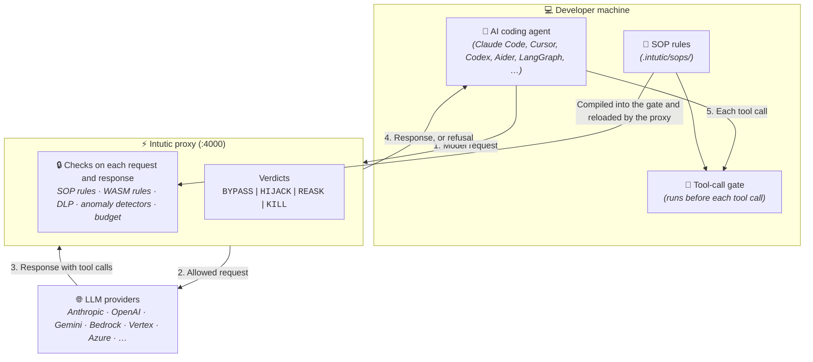

<div align="center">

# Intutic — The Circuit Breaker for AI Agents

**Policy as code for AI agents: your rules are files in git, enforced at the tool call across 43 agent harnesses.**

[](https://github.com/intutic/intutic)
[](https://www.npmjs.com/package/@intutic/cli)
[](https://opensource.org/licenses/MIT)
[](https://docs.intutic.ai)
[](https://intutic.ai)
[](https://join.slack.com/t/intuticai/shared_invite/zt-44nmni7r6-W2xts5vAHe90L_ExXfkXVw)
[](https://x.com/IntuticAI)

[Website](https://intutic.ai) • [Documentation](https://docs.intutic.ai) • [Main Repository](https://github.com/intutic/intutic) • [Slack](https://join.slack.com/t/intuticai/shared_invite/zt-44nmni7r6-W2xts5vAHe90L_ExXfkXVw)


</div>

---

## 💡 About Intutic

Observability tools log what an agent did *after* it leaked a secret, deleted files or looped on a paid API.

**Intutic is an active circuit breaker at the tool call.** Your rules are Markdown files in `.intutic/sops/`. A gate installed in each agent harness checks every tool call against them before it runs, and a local proxy checks the model traffic. Dangerous commands are refused, secrets are redacted, and loops are steered or stopped. The policy check is a rule decision, not a model call; rules that need a judgement can ask your own self-hosted model.

---

## 📦 Key Repositories in the Intutic Ecosystem

| Repository | Description | Stars / Status |
| :--- | :--- | :--- |
| 🛡️ [**`intutic/intutic`**](https://github.com/intutic/intutic) | The open-core repository: the Rust proxy, `@intutic/cli`, the tool-call gates (`@intutic/gate` for TypeScript, `intutic-clawde` for Python), the `@intutic/clawde` client SDK, the MCP governance proxy and the WASM rules SDK. | [](https://github.com/intutic/intutic) |

---

## 🏗️ Architecture Overview



---

## ⚡ Quickstart (30 Seconds)

### 1. Install Global CLI & Native Proxy
```bash
npm install -g @intutic/cli @intutic/proxy
```

### 2. Install the Gates
```bash
intutic init
intutic gates install
```
This detects the coding agents in your project and installs a blocking gate in each.

### 3. Start the Proxy
```bash
intutic start
```
No account, no Docker, no config file. Everything runs on your machine.

### 4. Route Your Agent
```bash
# Anthropic SDK and Claude Code append /v1/messages themselves — host only.
export ANTHROPIC_BASE_URL="http://localhost:4000"
export OPENAI_BASE_URL="http://localhost:4000/v1"
```

---

## 🔌 Supported Harnesses & Frameworks

Intutic ships **43 harness adapters**:

* **Native hook gates** (no change to your agent's code): Claude Code, Cursor, Windsurf, Cline, Codex, Goose, GitHub Copilot, OpenCode and more.
* **SDK-gated frameworks** (an in-process gate you add to your agent): LangGraph, LangChain, CrewAI, AutoGen, AG2, Google ADK, OpenAI Agents SDK, Pydantic AI, smolagents, AWS Strands Agents, Microsoft Agent Framework, Mastra, Vercel AI SDK and more.
* **Through the proxy alone:** Aider, Claude Desktop, Roo Code, Continue (these also use the MCP governance proxy where they have MCP), and anything else that honours `OPENAI_BASE_URL` or `ANTHROPIC_BASE_URL`.

The full list is in the [main repository](https://github.com/intutic/intutic#-supported-harnesses--frameworks).

---

## 🌐 Community & Links

* 📖 **Documentation Portal:** [docs.intutic.ai](https://docs.intutic.ai)
* 🌐 **Official Website:** [intutic.ai](https://intutic.ai)
* 💬 **Slack Community:** [Join Intutic Slack](https://join.slack.com/t/intuticai/shared_invite/zt-44nmni7r6-W2xts5vAHe90L_ExXfkXVw)
* 🐤 **Follow on X:** [@IntuticAI](https://x.com/IntuticAI)
* 💼 **LinkedIn Page:** [Intutic on LinkedIn](https://www.linkedin.com/company/intutic-ai/)
* 📧 **Contact Support:** [support@intutic.ai](mailto:support@intutic.ai)

---

<div align="center">

© 2026 Intutic Community. All rights reserved. Licensed under the [MIT License](https://opensource.org/licenses/MIT).

</div>
